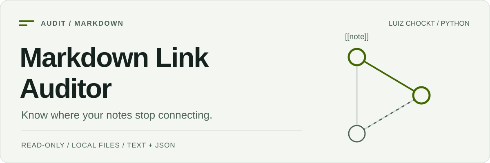

<picture>
  <source media="(prefers-color-scheme: dark) and (max-width: 600px)" srcset="./assets/cover-mobile-dark.svg">
  <source media="(max-width: 600px)" srcset="./assets/cover-mobile-light.svg">
  <source media="(prefers-color-scheme: dark)" srcset="./assets/cover-dark.svg">
  <source media="(prefers-color-scheme: light)" srcset="./assets/cover-light.svg">
  
</picture>

# Markdown Link Auditor

[Português brasileiro](./README.pt-BR.md) · [Full reference](./docs/reference.md) · [Sample report](./examples/reports/sample-report.txt)

[](https://github.com/LuizChockt/markdown-link-auditor/actions/workflows/tests.yml)

**Find broken local links, missing attachments, ambiguous references and potential orphan notes in Markdown knowledge bases.**

Built for folders of notes and Obsidian-style vaults. It reads your Markdown, resolves destinations against a local index and produces reproducible text or JSON reports. Your notes are never edited.

## Quick start

Requires **Python 3.11+**. Install from the source checkout; a PyPI release is not assumed.

```bash
git clone https://github.com/LuizChockt/markdown-link-auditor.git
cd markdown-link-auditor
python -m venv .venv
```

**Windows PowerShell** — activation is not required:

```powershell
.\.venv\Scripts\python.exe -m pip install .
.\.venv\Scripts\python.exe -m markdown_auditor examples/sample-vault
```

**Linux / macOS** — use `python3` to create the environment if needed:

```bash
.venv/bin/python -m pip install .
.venv/bin/python -m markdown_auditor examples/sample-vault
```

The installed `markdown-auditor` command has the same interface. The only runtime dependency is **markdown-it-py**.

## What a run tells you

The included synthetic vault produces **8 scanned notes, 2 broken links, 1 ambiguous link and 4 potential orphan notes**. [Read the actual text report](./examples/reports/sample-report.txt) or [inspect the JSON](./examples/reports/sample-report.json).

```bash
python -m markdown_auditor examples/sample-vault --format json
python -m markdown_auditor examples/sample-vault --exclude "Python/**"
python -m markdown_auditor examples/sample-vault --format json --output audit-report.json
```

Use your environment's Python path for these commands. A saved report must be a **new file outside the audited folder**, with an existing parent directory.

## Capabilities and boundaries

| Capability | Behavior |
| --- | --- |
| CommonMark + Obsidian links | Inline, image, reference-style, wikilinks, aliases and embeds. |
| Local resolution | Unicode-aware, case-insensitive matching; duplicate targets remain ambiguous. |
| Backlinks | Potential orphans have no confirmed incoming link from another scanned note. |
| Reporting | Stable ordering, source line numbers, repeatable exclusions, text and JSON. |
| Safe scope | No repairs; no traversal of symlinks/reparse points inside the selected root. |
| External URLs | Counted and left unchecked; **no HTTP requests**. |

Headings and block IDs are not validated. An orphan may be intentional. Exit **0 means the audit completed**, even when findings exist; **1** means read errors; **2** means invalid input or output errors. [Resolution rules and limitations](./docs/reference.md#resolution-rules).

## Engineering

Scanning, parsing, resolution, auditing and reporting live in separate modules. Tests exercise real CLI entry points, scope boundaries, Unicode collisions, reproducible examples and unchanged vault contents.

```bash
python -m pip install -e ".[dev]"
python -m pytest
```

GitHub Actions runs the suite on **Linux, Windows and macOS**, using Python **3.11 and 3.14**. The badge links to live results rather than a manually maintained claim.

[Architecture and detailed usage](./docs/reference.md#project-structure) · [Contributing](./CONTRIBUTING.md) · [Security](./SECURITY.md) · [MIT License](./LICENSE)
