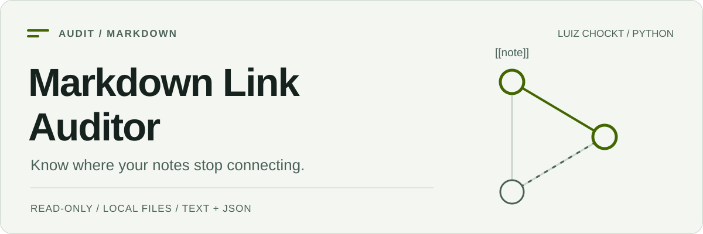

<picture>
  <source media="(prefers-color-scheme: dark) and (max-width: 600px)" srcset="./assets/cover-mobile-dark.svg">
  <source media="(max-width: 600px)" srcset="./assets/cover-mobile-light.svg">
  <source media="(prefers-color-scheme: dark)" srcset="./assets/cover-dark.svg">
  <source media="(prefers-color-scheme: light)" srcset="./assets/cover-light.svg">
  
</picture>

# Markdown Link Auditor

[English](./README.md) · [Referência completa em inglês](./docs/reference.md) · [Relatório de exemplo](./examples/reports/sample-report.txt)

[](https://github.com/LuizChockt/markdown-link-auditor/actions/workflows/tests.yml)

**Encontra links locais quebrados, anexos ausentes, referências ambíguas e possíveis notas órfãs em bases Markdown.**

Feito para pastas de notas e vaults no estilo Obsidian. Lê Markdown, resolve destinos em um índice local e gera relatórios reproduzíveis em texto ou JSON, sem editar as notas.

## Início rápido

Requer **Python 3.11+**. A instalação utiliza o código do repositório; não pressupõe publicação no PyPI.

```bash
git clone https://github.com/LuizChockt/markdown-link-auditor.git
cd markdown-link-auditor
python -m venv .venv
```

**Windows PowerShell**, sem ativar scripts:

```powershell
.\.venv\Scripts\python.exe -m pip install .
.\.venv\Scripts\python.exe -m markdown_auditor examples/sample-vault
```

**Linux / macOS** — usa `python3` para criar o ambiente, se necessário:

```bash
.venv/bin/python -m pip install .
.venv/bin/python -m markdown_auditor examples/sample-vault
```

O comando instalado `markdown-auditor` oferece a mesma interface. A única dependência de execução é **markdown-it-py**.

## Resultado concreto

O vault fictício incluído gera **8 notas lidas, 2 links quebrados, 1 referência ambígua e 4 possíveis notas órfãs**. Confere o [relatório em texto](./examples/reports/sample-report.txt) ou o [JSON](./examples/reports/sample-report.json).

```bash
python -m markdown_auditor examples/sample-vault --format json
python -m markdown_auditor examples/sample-vault --exclude "Python/**"
python -m markdown_auditor examples/sample-vault --format json --output audit-report.json
```

Utiliza o caminho do Python do teu ambiente. Um relatório salvo deve ser um **arquivo novo fora da pasta auditada**, em uma pasta já existente.

## Recursos e limites

| Recurso | Comportamento |
| --- | --- |
| CommonMark e Obsidian | Links inline, imagens, referências, wikilinks, aliases e embeds. |
| Resolução local | Normalização Unicode, comparação sem distinguir maiúsculas e ambiguidades explícitas. |
| Notas órfãs | Candidatas sem links de entrada confirmados de outra nota lida. |
| Relatórios | Ordem estável, linhas de origem, exclusões repetíveis, texto e JSON. |
| Escopo | Sem reparos nem travessia de symlinks/reparse points dentro da raiz selecionada. |
| URLs externas | Contadas sem consulta; **nenhuma requisição HTTP**. |

Não valida headings ou block IDs. Uma nota órfã pode ser intencional. O código de saída **0 indica auditoria concluída**, mesmo com achados; **1**, erros de leitura; **2**, entrada ou saída inválida. [Regras e limitações](./docs/reference.md#resolution-rules).

## Engenharia

Módulos separados para varredura, parsing, resolução, auditoria e relatórios. Os testes executam CLIs reais e verificam limites de acesso, colisões Unicode, exemplos reproduzíveis e preservação do vault.

```bash
python -m pip install -e ".[dev]"
python -m pytest
```

O GitHub Actions executa a suíte em **Linux, Windows e macOS**, com Python **3.11 e 3.14**. O badge aponta para os resultados atuais.

[Arquitetura e uso detalhado](./docs/reference.md#project-structure) · [Contribuição](./CONTRIBUTING.md) · [Segurança](./SECURITY.md) · [Licença MIT](./LICENSE)
